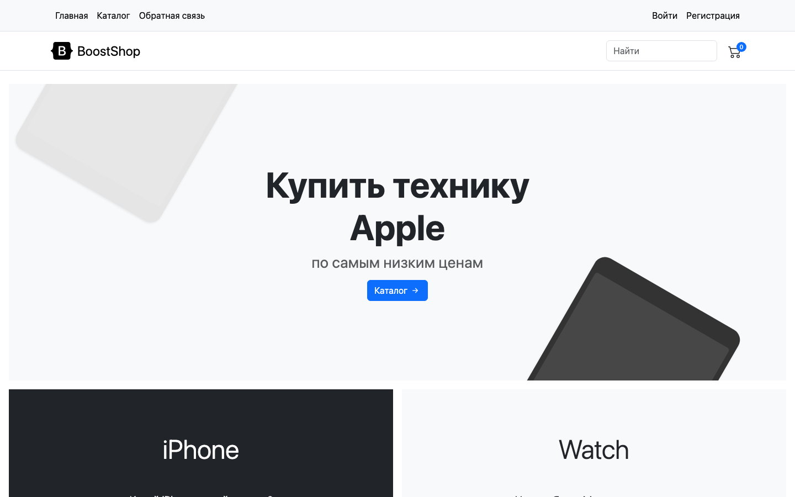
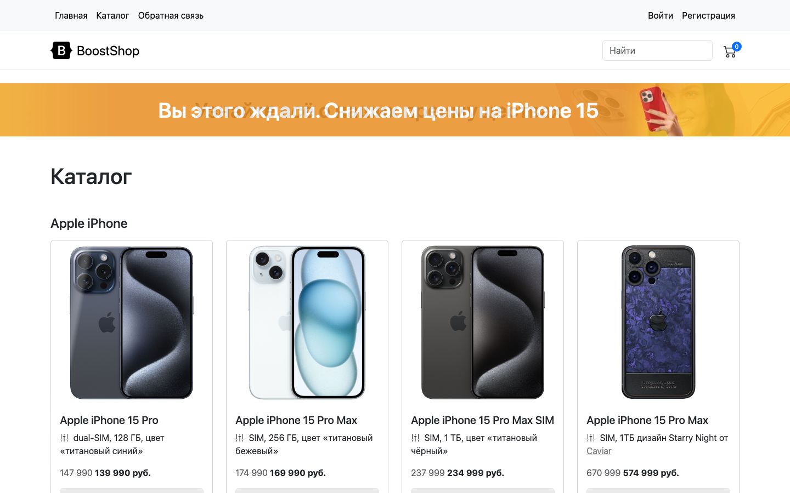
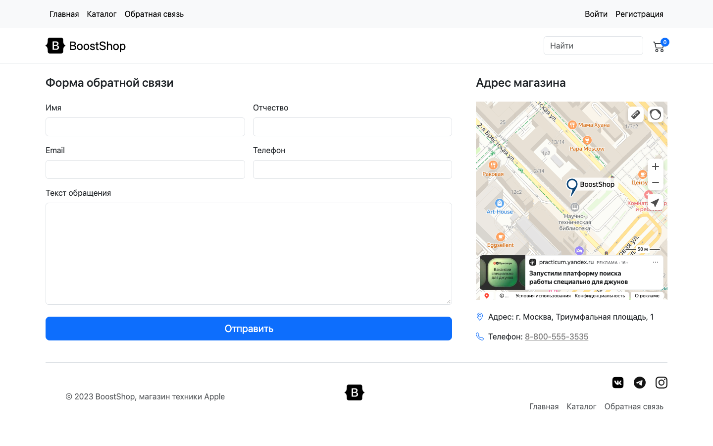
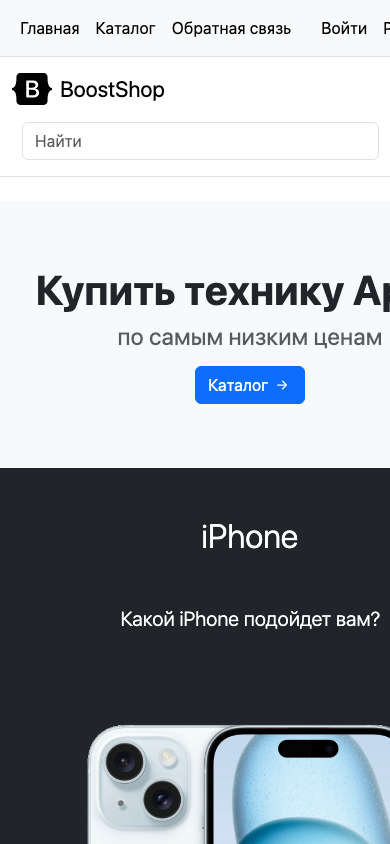

# Tech Shop (BoostShop)

Учебный интернет-магазин техники Apple: адаптивная вёрстка на HTML/CSS/Bootstrap и заготовка REST API на Node.js + PostgreSQL.

**Демо:** https://kxkirov.github.io/tech-shop/

> GitHub Pages показывает только фронтенд. Бэкенд из папки `server/` запускается локально (см. ниже).

## Задача

Сделать витрину магазина электроники:

- главная страница с промо-блоками по категориям (iPhone, Watch, iPad, Mac и т. д.);
- каталог с карточками товаров, ценами и скидками;
- корзина со счётчиком товаров в шапке;
- страница обратной связи с формой;
- корректное отображение на телефоне;
- спроектировать базу данных и API для товаров, категорий и пользователей.

## Что сделано

**Фронтенд** (`main/`, `css/`, `js/`)

- Три страницы: главная, каталог и обратная связь — с общей шапкой, поиском и футером.
- Сетка и компоненты на Bootstrap 5, свои стили в `css/style.css`; адаптивные баннеры (отдельные картинки для мобильных).
- Слайдер баннеров на Swiper.
- Корзина на чистом JS (`js/basket.js`): товары добавляются и убираются кнопкой на карточке, состояние хранится в `localStorage`, счётчик в шапке обновляется и сохраняется между страницами.

**Бэкенд** (`server/`)

- Express-сервер с роутами `/api/user`, `/api/item`, `/api/category`, `/api/colors`, `/api/generation`.
- Модели Sequelize для PostgreSQL: пользователи, корзина и её позиции, товары, характеристики товаров, категории, цвета, поколения; связи «один ко многим» и «многие ко многим» через промежуточные таблицы.
- Загрузка изображений товаров (`express-fileupload`, имена файлов — UUID).
- Централизованная обработка ошибок через собственный класс `ApiError` и middleware.
- Настройки подключения к БД — через переменные окружения (`.env`).

### Запуск бэкенда локально

```bash
cd server
cp .env.example .env   # заполнить данные своей PostgreSQL
npm install
npm run dev
```

## Скриншоты

| Главная | Каталог |
|---|---|
|  |  |

| Обратная связь | Мобильная версия |
|---|---|
|  |  |

## Инструменты

- HTML5, CSS3, Bootstrap 5, Swiper, Font Awesome
- JavaScript (DOM, `localStorage`)
- Node.js, Express
- PostgreSQL, Sequelize ORM
- dotenv, cors, express-fileupload, uuid, nodemon
- Git, GitHub Pages

## Что бы улучшил

- **Связать фронтенд с API.** Сейчас карточки каталога свёрстаны вручную; их стоит загружать из `/api/item` и рендерить динамически.
- **Доделать авторизацию.** `registration` и `login` пока пустые: нужны хеширование паролей (bcrypt), JWT и защищённые маршруты.
- **Полноценная корзина.** Страница корзины с количеством и суммой, синхронизация с таблицей `basket` для авторизованных пользователей.
- **Работающая форма обратной связи** с валидацией и отправкой на сервер.
- **Свои изображения.** Часть фото товаров подгружается со сторонних сайтов — лучше хранить их у себя и оптимизировать (WebP, `loading="lazy"`).
- **Убрать дублирование вёрстки.** Шапка и футер копируются в каждую страницу; можно вынести в шаблоны или перейти на компонентный фреймворк.
- **Качество кода:** ESLint/Prettier, тесты API, миграции вместо `sequelize.sync()`, деплой бэкенда (Render/Railway) с облачной PostgreSQL.
